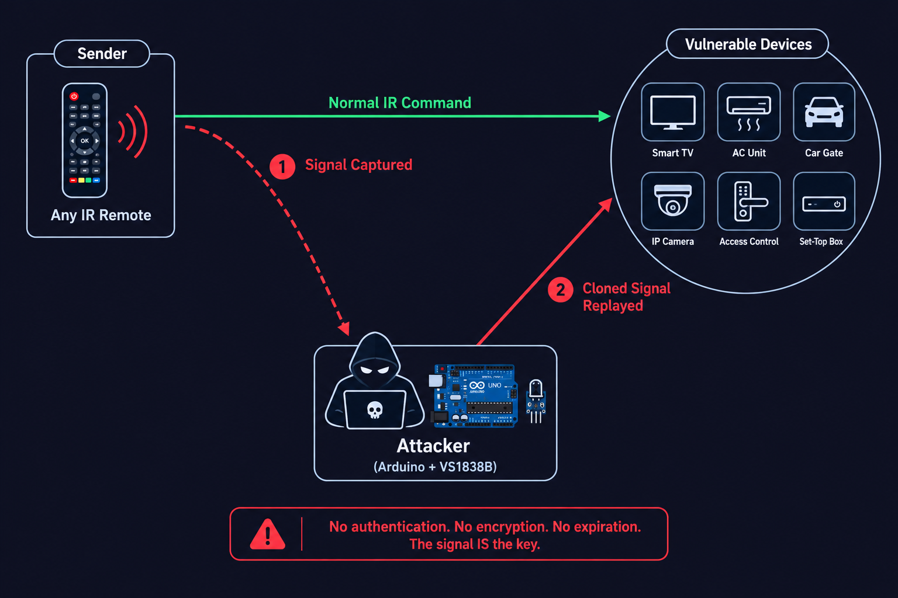
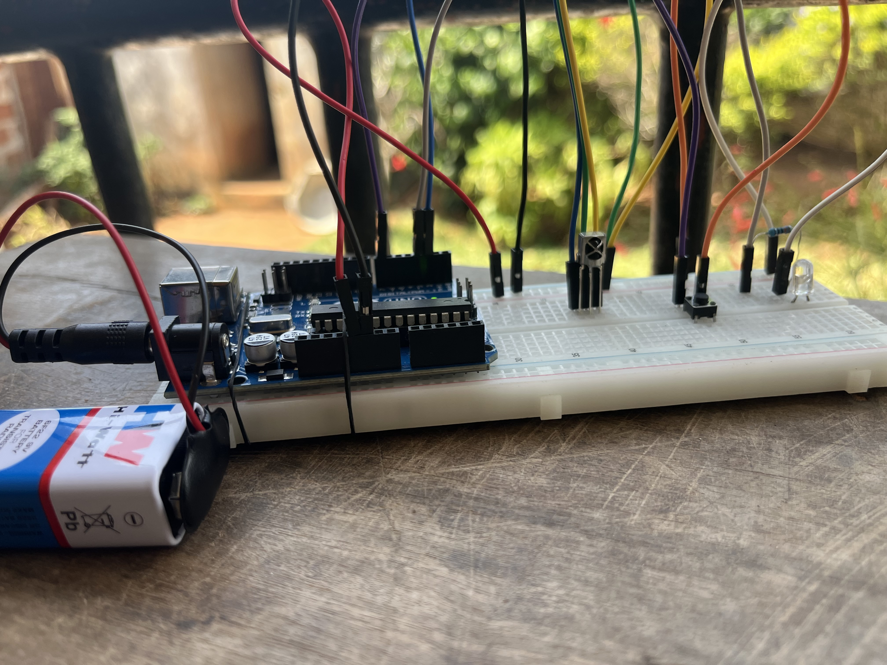

# IR Replay Attack Tool

Capture any IR remote signal and replay it on command. A working proof of concept that demonstrates the complete absence of authentication in infrared communication. Point a TV remote at the Arduino, press a button, then replay that exact signal with a physical pushbutton to control the TV without the remote.


**Related:** This project builds on [12 : IR Remote Control](https://github.com/FreemenTech/arduino-learning/tree/main/12-IR-remote-control), where we first decoded NEC protocol signals. Here we weaponize that knowledge.

## What This Proves

IR protocols like NEC have **zero authentication**. There is no handshake, no rolling code, no encryption. The signal is the key. Anyone who captures it can replay it. This is the same principle behind IR attacks on:

- Hotel TV systems (accessing hidden admin menus)
- Air conditioning units in server rooms
- IR-controlled access systems (gates, barriers)
- Flipper Zero IR module attacks

## Components

| Component | Role |
|-----------|------|
| Arduino UNO R3 | Microcontroller |
| VS1838B IR receiver (pin 2) | Captures incoming IR signals |
| IR LED emitter (pin 3) | Replays captured signals. Pin 3 required for hardware timer |
| 220 Ohm resistor (x2, parallel) | Current limiting for IR LED. Two in parallel = 110 Ohm for stronger emission |
| Pushbutton (pin 7) | Triggers replay. INPUT_PULLUP, active LOW |

## Circuit

```
VS1838B IR Receiver:
  OUT -> Arduino pin 2
  GND -> GND
  VCC -> 5V

IR LED Emitter:
  Arduino pin 3 -> two 220 Ohm resistors in parallel -> LED anode (+) -> cathode (-) -> GND

Pushbutton:
  One leg -> Arduino pin 7
  Other leg -> GND
  (no external resistor, uses INPUT_PULLUP)
```

## Supported Protocols

The tool automatically detects and replays multiple IR protocols:

| Protocol | Used by |
|----------|---------|
| NEC | LG, Chinese remotes, many consumer devices |
| Sony (SIRC) | Sony TV, PlayStation |
| Samsung | Samsung TV (proprietary protocol) |
| RC5 | Philips, set-top boxes |
| RC6 | Microsoft MCE, Xbox |

The captured protocol is detected automatically. The replay uses the matching sender function, making the tool universal across brands.

## How It Works

**Phase 1 : Capture**

1. Point any compatible remote at the VS1838B
2. Press a button on the remote
3. Arduino detects the protocol, extracts `address` and `command`
4. Signal stored in memory. Serial prints protocol, address, and command

**Phase 2 : Replay**

1. Press the physical pushbutton on pin 7
2. `IrReceiver.stop()` disables the receiver to prevent feedback loop
3. The matching sender fires (sendNEC, sendSony, sendSamsung, etc.) with 3 repeats
4. 500ms delay, wait for button release, then `IrReceiver.start()` brings receiver back online
5. Target device executes the command

## Key Technical Decisions

### Why a physical button instead of the remote's button?

First version used the remote's # button to trigger replay. Problem: pressing # sends an IR signal that the VS1838B captures, **overwriting the stored signal** before replay happens. The remote replaces your payload with its own command. A physical pushbutton generates no IR, giving a clean trigger.

### Why stop/start the receiver during replay?

The IR LED and VS1838B sit centimeters apart on the breadboard. When the LED emits, the receiver picks it up instantly, creating a **feedback loop**. The Arduino captures its own emission, floods Serial with garbage data, and corrupts the stored signal. `IrReceiver.stop()` before sending and `IrReceiver.start()` after eliminates this.

### Why 3 repeats?

A single signal without repeats gets ignored by some TVs (tested on LG). Real TV remotes always send multiple repeats. Using `sendNEC(address, command, 3)` sends 4 frames total (1 original + 3 repeats), matching real remote behavior.

### Why two 220 Ohm resistors in parallel?

100 Ohm is ideal for maximum IR LED range (3-4m). With only 220 Ohm and 1K Ohm available, two 220 Ohm in parallel gives 110 Ohm, close to the ideal value. One 220 Ohm alone was too weak for the TV to receive reliably.

### Why pin 3 for IR LED?

`IrSender` uses hardware Timer2 on the UNO, which outputs PWM on pin 3. Other pins cannot generate the 38kHz carrier frequency needed for IR transmission.

## Attack Flow

```
[Any Remote] --IR signal--> [VS1838B] --decode--> [Arduino stores protocol+address+command]
                                                            |
                                                       [Button press]
                                                            |
                                                 [IrReceiver.stop()]
                                                            |
                                                 [Matching sender fires]
                                                            |
[Target Device] <--IR signal-- [IR LED] <-------[IrReceiver.start()]
```

## Tested Results

- **LG TV** : captured power-off command, replay turns off TV
- **LG TV** : captured Netflix shortcut, replay opens Netflix
- **LG TV** : captured volume, mute, input commands, all replay successfully
- Range with parallel 220 Ohm resistors: approximately 1-2 meters (line of sight)

## Bugs Encountered and Fixed

| Bug | Cause | Fix |
|-----|-------|-----|
| Replay sends wrong command | Remote's # button overwrites stored signal | Physical pushbutton trigger (no IR emission) |
| Serial floods with `Recu -> 0x0` | VS1838B captures IR LED's own emission | `IrReceiver.stop()` / `start()` around send |
| IR LED does nothing | Wrong pin, timer mismatch | Move LED to pin 3 (Timer2 PWM output) |
| TV ignores replay signal | Single send without repeats | Added 3 repeats to all sender functions |
| Weak signal, short range | Single 220 Ohm resistor | Two 220 Ohm in parallel (110 Ohm effective) |
| Replay spams multiple times | Button held during fast loop | `while(btn == LOW)` waits for release |

## Security Angle

### Why IR is fundamentally broken

- **No authentication** : the signal IS the credential
- **No encryption** : commands travel in cleartext
- **No replay protection** : same signal works unlimited times
- **No pairing** : any device on the same protocol responds

### Comparison with RF key fobs

| | IR (NEC) | RF Key Fob (KeeLoq) |
|---|----------|---------------------|
| Authentication | None | Rolling code |
| Replay possible? | Always | Requires RollJam attack |
| Range | 1-5m line of sight | 10-100m, through walls |
| Attack difficulty | Trivial (this project) | Advanced (SDR + timing) |

### Real-world impact

This exact technique scales to any IR-controlled device. Flipper Zero's IR module does the same thing with a better antenna. The fix? IR should never be used for security-critical functions, but it still is, everywhere.

## How to Defend Against IR Replay

IR is broken by design, but these countermeasures exist in more secure protocols:

### Rolling codes

Each transmission uses a different code generated by a synchronized counter between emitter and receiver. Once a code is used, it is rejected on replay. This is how modern car key fobs (KeeLoq, AUT64) work. The receiver accepts only the next expected code in the sequence.

**Weakness:** the RollJam attack (Samy Kamkar, 2015) jams the receiver while capturing two consecutive codes. The first code is never received, so it stays valid. The attacker replays it later.

### Encrypted payload

The command is encrypted with a shared key between the remote and the device. Without the key, a captured signal is meaningless noise. Even if replayed byte-for-byte, some implementations tie the encryption to a session or timestamp, making the captured frame expire.

**Example:** some high-end AC systems and industrial IR controls use AES-128 encrypted IR frames.

### Challenge-response authentication

The receiver sends a random challenge. The remote must respond with the correct answer (computed from the challenge + a shared secret). A replayed response fails because the challenge changes every time.

**Tradeoff:** requires two-way IR communication (emitter + receiver on both sides), which adds cost and complexity.

### Sequential counters

Each command includes an incrementing counter. The receiver rejects any command with a counter value equal to or lower than the last accepted one. Simple but effective against basic replay.

### Why none of this is used on TVs

Cost. A TV remote costs $0.50 to manufacture. Adding crypto, rolling codes, or two-way communication raises the BOM. The threat model says "nobody is going to hack a TV remote," so manufacturers skip security entirely. This is the same logic that leaves most IoT devices unprotected.

The real lesson: **security is a cost decision, not a technical one.** The countermeasures exist. They are just not deployed where the perceived risk is low.

## Responsible Disclosure

This tool was built and tested on **my own LG TV** in a controlled environment. IR replay is a well-documented vulnerability class. The goal is to understand the attack surface before learning to defend against it.

**Methodology:** Build PoC, test on own equipment, document, recommend remediation.

## What I Learned

1. IR protocols have zero authentication. The signal is the only credential
2. Physical proximity between receiver and emitter creates feedback loops that must be managed in software
3. The trigger mechanism matters. Using the same channel (IR) for both capture and trigger creates logical conflicts
4. Hardware timer constraints dictate pin assignments (Timer2 to pin 3 for 38kHz PWM)
5. Repeats matter. Some devices ignore a single IR frame and need multiple repeats to respond
6. Multi-protocol support makes the tool universal instead of brand-specific
7. Real security tools start as simple PoCs. Flipper Zero's IR module is fundamentally this same code with better hardware

## Versions

| Version | Features |
|---------|----------|
| **v1 (this)** | Capture, multi-protocol replay, single signal in RAM |
| [**v2 (EEPROM)**](https://github.com/FreemenTech/IR-Replay-Attack-Tool/tree/main/v2-eeprom) | Signal persists after reboot using EEPROM storage |

## Author

**Freemen Houngbedji** : Cybersecurity student. Building toward IoT security
